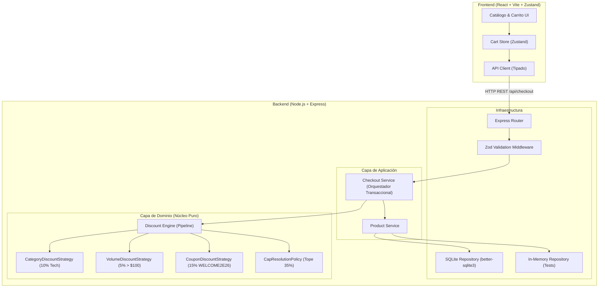

# Arquitectura del Sistema — Kata E-Commerce

## 1. Resumen Ejecutivo y Decisiones Fundamentales

Este documento formaliza la arquitectura del MVP de checkout de e-commerce con motor de descuentos acumulativos y consistencia de inventario. Ha sido diseñado para cumplir con principios de modularidad, tipado estricto, desacoplamiento y sustentabilidad técnica ante un panel evaluador.

### Decisiones Técnicas Acordadas

| Dimensión | Decisión Adoptada | Justificación Técnica |
| :--- | :--- | :--- |
| **Precisión Monetaria** | **Enteros en Centavos (`cents: number`)** | Evita la pérdida de precisión y bugs de punto flotante en IEEE 754 de JavaScript (`0.1 + 0.2 = 0.30000000000000004`). \$100.50 se modela como `10050`. Redondeos en un único punto predecible. |
| **Resolución del Tope (35%)** | **Precedencia LIFO con desglose dual (`calculado` vs `aplicado`)** | Respeta el orden de las reglas (Categoría $\rightarrow$ Volumen $\rightarrow$ Cupón). Las primeras aplican íntegras y la última absorbe el recorte por tope. |
| **Backend Stack** | **Node.js + Express + Zod + TypeScript** | Estándar de la industria, tipado estricto de extremo a extremo y validación en tiempo de ejecución (runtime schema validation) sin sobre-ingeniería. |
| **Frontend Stack** | **React + Vite + Tailwind CSS + Zustand** | Renderizado reactivo rápido, gestión de estado predecible y desacoplada de la vista sin boilerplate de Redux/Context providers complejos. |
| **Persistencia** | **Patrón Repository dual: SQLite (`better-sqlite3`) + InMemory** | Persistencia real con transacciones ACID para evitar sobreventa de stock en producción/demo, y repositorio en memoria para tests unitarios instantáneos sin I/O. |
| **Testing** | **Vitest + React Testing Library** con cobertura $\ge$ 80% | Configuración unificada y rápida tanto para frontend como para backend con `@vitest/coverage-v8`. |

---

## 2. Diagrama de Arquitectura y Separación de Capas

El principio rector es la **independencia del dominio**: el motor de descuentos y las entidades de negocio no dependen de Express, de React, de la base de datos ni del transporte HTTP.



---

## 3. Patrones de Diseño Implementados

### 3.1. Patrón Strategy (Motor de Descuentos)
* **Problema que resuelve**: Acumulación caótica de condiciones `if/else` en un único método monolítico.
* **Ubicación**: `apps/backend/src/domain/engine/strategies/`
* **Implementación**: Interfaz `IDiscountStrategy` que obliga a cada regla a encapsular su condición de elegibilidad, su base de cálculo y su cálculo monetario.
  ```typescript
  export interface IDiscountStrategy {
    readonly id: 'CATEGORY' | 'VOLUME' | 'COUPON';
    readonly name: string;
    calculate(context: DiscountContext): StrategyCalculationResult;
  }
  ```
* **Ventajas**: Cumple con el Principio Open/Closed (OCP). Se pueden agregar nuevas reglas (ej. Black Friday) sin modificar el motor de resolución.
* **Trade-off**: Mayor número de clases o funciones que un simple script plano, justificado por la necesidad de probar cada regla de forma 100% aislada.

### 3.2. Patrón Repository (Acceso a Datos e Inventario)
* **Problema que resuelve**: Acoplamiento entre la lógica de negocio del checkout y el motor de almacenamiento (SQLite o Memoria).
* **Ubicación**: `apps/backend/src/domain/repositories/`
* **Implementación**:
  ```typescript
  export interface IProductRepository {
    findById(id: string): Promise<Product | null>;
    findAll(): Promise<Product[]>;
    decrementStockAtomic(items: Array<{ productId: string; quantity: number }>): Promise<boolean>;
  }

  export interface IOrderRepository {
    create(order: Order): Promise<Order>;
    findById(id: string): Promise<Order | null>;
  }
  ```
* **Ventajas**: Permite ejecutar pruebas unitarias con `InMemoryProductRepository` en milisegundos, e intercambiarlo por `SQLiteProductRepository` con transacciones ACID para la aplicación real.

---

## 4. El Motor de Descuentos (Reglas Matemáticas y Consistencia)

### 4.1. Orden de Precedencia y Fórmulas en Centavos

1. **Subtotal Original**:
   $$\text{subtotalOriginal} = \sum (\text{precioUnitarioCentavos} \times \text{cantidad})$$

2. **Regla 1: Categoría (Tecnología)**:
   $$\text{subtotalTecnologia} = \sum (\text{items con categoría 'Tecnología'})$$
   $$\text{descCategoria} = \text{round}(\text{subtotalTecnologia} \times 0.10)$$

3. **Regla 2: Volumen (> \$100.00 = > 10,000 centavos)**:
   $$\text{subtotalAjustado} = \text{subtotalOriginal} - \text{descCategoria}$$
   $$\text{descVolumen} = \begin{cases} \text{round}(\text{subtotalAjustado} \times 0.05) & \text{si } \text{subtotalAjustado} > 10000 \\ 0 & \text{en otro caso} \end{cases}$$

4. **Regla 3: Cupón Promocional (`WELCOME2E26`)**:
   Valida código (normalizado sin espacios y en mayúsculas).
   $$\text{subtotalTrasVolumen} = \text{subtotalAjustado} - \text{descVolumen}$$
   $$\text{descCupon} = \begin{cases} \text{round}(\text{subtotalTrasVolumen} \times 0.15) & \text{si cupón es válido} \\ 0 & \text{en otro caso} \end{cases}$$

5. **Regla 4: Tope Absoluto del 35% y Distribución LIFO**:
   $$\text{descuentoCalculado} = \text{descCategoria} + \text{descVolumen} + \text{descCupon}$$
   $$\text{descuentoMaximo} = \text{round}(\text{subtotalOriginal} \times 0.35)$$
   $$\text{descuentoEfectivoTotal} = \min(\text{descuentoCalculado}, \text{descuentoMaximo})$$
   $$\text{isCapReached} = (\text{subtotalOriginal} > 0) \land (\text{descuentoCalculado} \ge \text{descuentoMaximo})$$

   **Mecanismo de ajuste LIFO**: Si $\text{descuentoCalculado} > \text{descuentoMaximo}$, el excedente $\Delta = \text{descuentoCalculado} - \text{descuentoMaximo}$ se descuenta primero del cupón. Si el cupón no cubre todo el excedente, se descuenta de volumen, y finalmente de categoría.

6. **Total a Pagar**:
   $$\text{totalPagar} = \text{subtotalOriginal} - \text{descuentoEfectivoTotal}$$

---

## 5. Contratos de la API REST

### `POST /api/checkout`
El cliente **nunca** envía precios ni totales calculados; solo envía la intención de compra.

#### Request Body
```json
{
  "items": [
    { "productId": "prod-1", "quantity": 2 },
    { "productId": "prod-2", "quantity": 1 }
  ],
  "couponCode": "WELCOME2E26"
}
```

#### Response Body (200 OK)
```json
{
  "orderId": "ord_1729012345_abc123",
  "status": "CONFIRMED",
  "summary": {
    "originalSubtotalCents": 15000,
    "discounts": {
      "category": { "calculatedCents": 1000, "appliedCents": 1000 },
      "volume": { "calculatedCents": 700, "appliedCents": 700 },
      "coupon": { "code": "WELCOME2E26", "calculatedCents": 1995, "appliedCents": 1995 }
    },
    "totalCalculatedDiscountCents": 3695,
    "totalEffectiveDiscountCents": 3695,
    "effectiveSavingsPercentage": 24.63,
    "isCapReached": false,
    "finalTotalCents": 11305
  },
  "items": [
    { "productId": "prod-1", "name": "Teclado Mecánico", "unitPriceCents": 5000, "quantity": 2 },
    { "productId": "prod-2", "name": "Camiseta Algodón", "unitPriceCents": 5000, "quantity": 1 }
  ]
}
```

---

## 6. Consistencia y Prevención de Concurrencia (Stock)

Para evitar la sobreventa de unidades ante solicitudes concurrentes:
1. En SQLite, la deducción de stock se ejecuta dentro de una transacción `BEGIN IMMEDIATE TRANSACTION`.
2. La actualización condicional asegura la consistencia atómica:
   ```sql
   UPDATE products 
   SET stock = stock - :quantity 
   WHERE id = :productId AND stock >= :quantity;
   ```
3. Si alguna fila no actualiza (porque el stock cayó por debajo de la cantidad deseada), la transacción se revierte inmediatamente (`ROLLBACK`) y se responde `409 Conflict` o `400 Bad Request` sin generar orden parcial.
